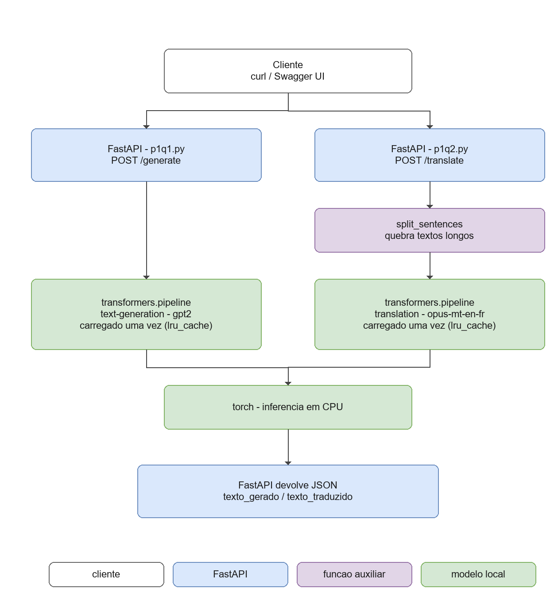
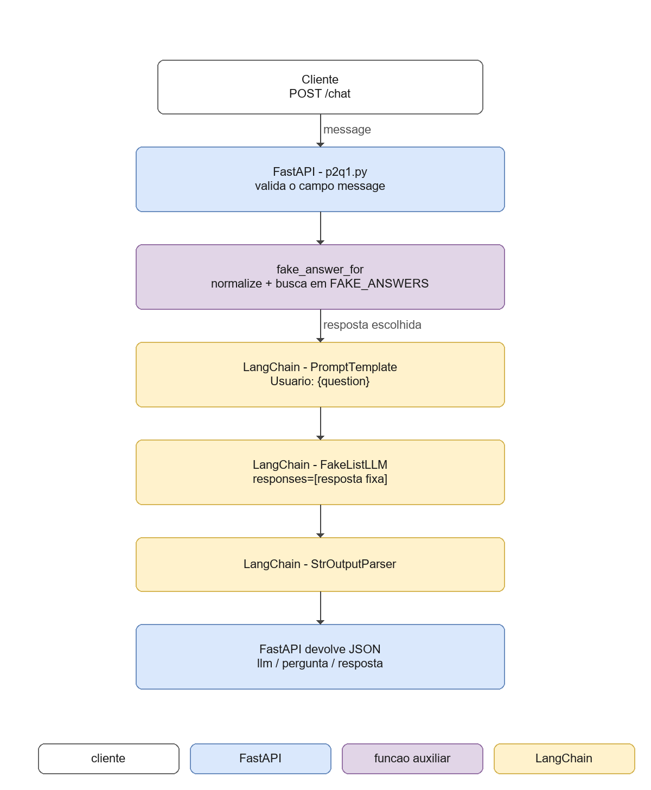
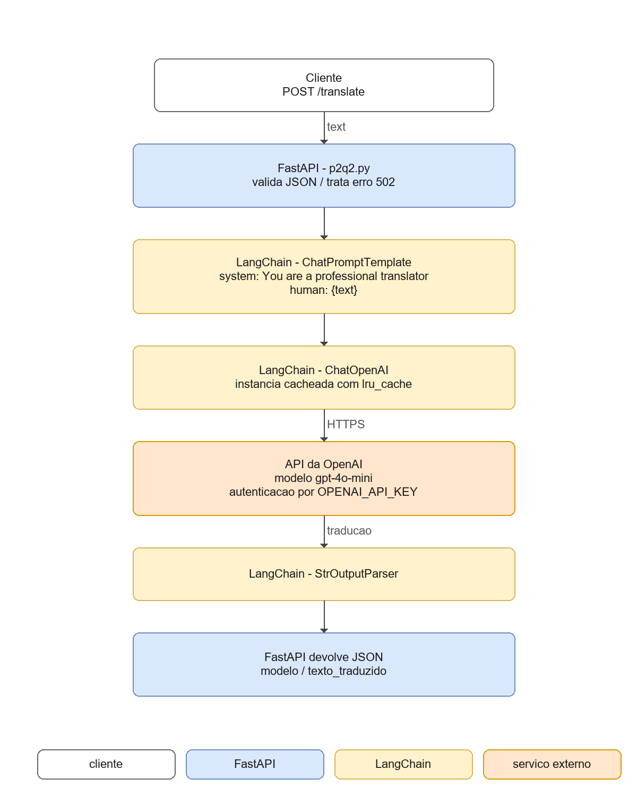
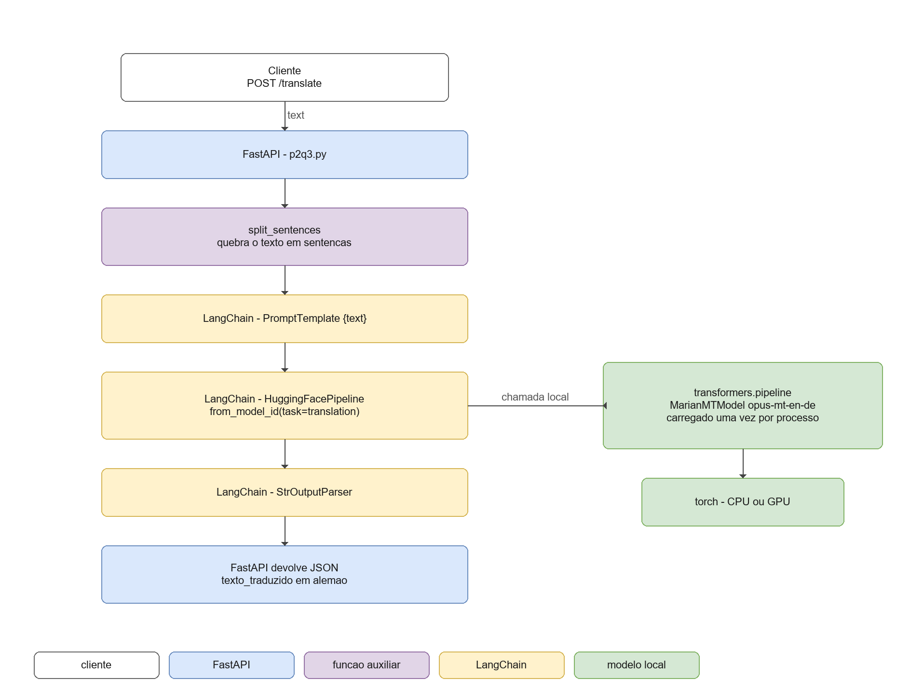

# TP2 - DR3 - FastAPI, HuggingFace e LangChain

**Aluno:** Pedro Perazzoli

**Repositorio GitHub:** [https://github.com/pperazzoli/dev-data-driven-tp2](https://github.com/pperazzoli/dev-data-driven-tp2)

Cada questao de implementacao e um app FastAPI independente, executado com `uvicorn <arquivo>:app`. As dependencias estao no `requirements.txt` do repositorio, e os diagramas deste documento tambem estao no arquivo editavel `diagramas.drawio`, uma pagina por questao.

| Arquivo | Questao | Endpoint |
|---|---|---|
| `p1q1.py` | Parte 1, Questao 1 - geracao de texto com GPT-2 | `POST /generate` |
| `p1q2.py` | Parte 1, Questao 2 - traducao EN-FR com Helsinki-NLP | `POST /translate` |
| `p2q1.py` | Parte 2, Questao 1 - chatbot com Fake LLM | `POST /chat` |
| `p2q2.py` | Parte 2, Questao 2 - traducao EN-FR com LangChain e OpenAI | `POST /translate` |
| `p2q3.py` | Parte 2, Questao 3 - traducao EN-DE com LangChain e HuggingFace | `POST /translate` |

# Parte 1 - FastAPI com HuggingFace

## Arquitetura da Parte 1

A Parte 1 roda os modelos localmente, sem LangChain e sem chamada de rede. Cada questao e um app independente: `p1q1.py` expoe `POST /generate` e `p1q2.py` expoe `POST /translate`. Os pipelines sao carregados uma unica vez por processo, com `lru_cache`.

## Questao 3: Limitacoes do modelo Helsinki-NLP/opus-mt-en-fr

**Resumo:** modelo pequeno e barato de rodar, com traducao literal frase a frase; erra em texto tecnico e em linguagem informal, e escala mal porque cada replica carrega o modelo inteiro na memoria.

### 1. Precisao da traducao

- O modelo e um MarianMT pequeno (cerca de 74 milhoes de parametros), treinado no corpus OPUS. Traduz bem frases gerais, mas erra em textos tecnicos, juridicos ou medicos, onde o vocabulario especializado quase nao aparece no treino.
- Nao tem memoria de contexto entre sentencas: cada frase e traduzida isoladamente, o que gera inconsistencia de genero, de tratamento (tu/vous) e de terminologia ao longo de um texto grande.
- Ambiguidades lexicais sao resolvidas pela estatistica do corpus, nao pelo sentido: "bank" pode virar "banque" mesmo quando se fala de margem de rio.
- Textos longos passam do limite de tokens e sao truncados. Na implementacao foi necessario quebrar o texto em sentencas, na funcao `translate_long`, para evitar perda de conteudo.
- Nao preserva bem formatacao, marcacao HTML, nomes proprios e numeros com unidade.

### 2. Tempo de resposta e desempenho em escala

- A primeira requisicao paga o custo de download (cerca de 300 MB) e de carregamento do modelo na memoria; por isso o pipeline e cacheado com `lru_cache`.
- Em CPU a inferencia e autorregressiva, gerando token por token: uma frase curta leva centenas de milissegundos e um paragrafo pode levar varios segundos.
- O endpoint e sincrono e o modelo roda no mesmo processo: requisicoes concorrentes competem pela CPU e pelo GIL, formando fila.
- Sem batching o throughput e baixo. Em producao seria necessario agrupar requisicoes, usar GPU, ONNX Runtime ou CTranslate2, ou ainda um servidor dedicado como TorchServe, Triton ou TGI.

### 3. Custo e escalabilidade

- Nao ha custo por token, mas ha custo fixo de infraestrutura: cada replica precisa de aproximadamente 1 GB de RAM apenas para modelo e runtime, e GPU encarece muito a hora de maquina.
- Escalar significa replicar o processo inteiro com o modelo dentro, o que gasta memoria de forma redundante e torna o cold start lento em ambientes serverless.
- Cada par de idiomas exige um modelo diferente (en-fr, en-de, en-pt), multiplicando consumo de memoria e complexidade de deploy.
- Em troca, o custo e previsivel e os dados nao saem da infraestrutura propria, o que e vantagem quando ha requisitos de privacidade.

### 4. Girias, expressoes idiomaticas e contexto

- Expressoes idiomaticas tendem a ser traduzidas literalmente: "it is raining cats and dogs" nao vira "il pleut des cordes".
- Girias, memes, abreviacoes de internet e erros de digitacao estao mal representados no corpus OPUS, formado em sua maior parte por textos oficiais, legendas e documentacao, o que gera saidas sem sentido.
- Nao ha controle de registro: nao e possivel pedir tom formal ou informal, nem fixar glossario, como se faria com um LLM instruido via prompt.
- Humor, ironia, duplo sentido e referencias culturais sao perdidos, porque o modelo nao modela intencao, apenas correspondencia estatistica entre sequencias.

## Questao 4: Limitacoes do GPT-2 na geracao de texto

**Resumo:** completa texto com fluencia, mas nao segue instrucoes, perde coerencia em poucas frases, alucina fatos e nao tem nenhum filtro de seguranca; a latencia cresce com o numero de tokens pedidos.

### 1. Coerencia do texto gerado

- O GPT-2 base, com 124 milhoes de parametros, mantem coerencia local por poucas frases e depois perde o fio: muda de assunto, repete estruturas e contradiz o que escreveu antes.
- A janela de contexto e de 1024 tokens; textos longos perdem o inicio do prompt.
- Com `do_sample=True` a saida muda a cada chamada, ou seja, nao e determinista; com sampling desligado, o texto cai em loops repetitivos.
- Nao segue instrucoes: e um modelo apenas de completacao, sem instruction tuning nem RLHF. Pedir "resuma isso" tende a produzir continuacao do texto, nao um resumo.

### 2. Falhas e incoerencias tipicas de LLMs

- Alucinacao: inventa nomes, datas, numeros e citacoes com total fluencia e nenhuma base factual.
- Conhecimento congelado em 2019, quando o corpus WebText foi coletado, sem qualquer acesso a informacao atual.
- Sensibilidade ao prompt: pequenas mudancas de redacao produzem saidas muito diferentes.
- Raciocinio aritmetico e logico pouco confiavel, por ser apenas um preditor do proximo token.
- Repeticao degenerativa e frases truncadas quando o limite de tokens e atingido no meio da sentenca.

### 3. Desempenho e latencia

- A geracao e autorregressiva: a latencia cresce linearmente com `max_new_tokens`, e em CPU cada token custa dezenas de milissegundos.
- O carregamento inicial do modelo, cerca de 500 MB, atrasa a primeira requisicao; o cache em memoria resolve somente a partir da segunda.
- Sem streaming, o cliente espera toda a geracao terminar; o ideal seria devolver tokens incrementalmente.
- Como o endpoint e sincrono e limitado por CPU, poucas requisicoes simultaneas ja saturam o servidor. Em escala seria necessario GPU, batching e um pool de workers.

### 4. Geracao de conteudo apropriado

- O GPT-2 nao tem alinhamento nem filtro de seguranca: pode gerar conteudo ofensivo, toxico, preconceituoso ou explicito a partir de prompts inocentes.
- Reproduz vieses de genero, raca e nacionalidade presentes no WebText.
- Pode memorizar e reproduzir trechos literais do treino, com risco de direito autoral e de vazamento de dados.
- Nao tem recusa, nem moderacao, nem citacao de fontes; qualquer uso real exigiria uma camada externa de filtragem de conteudo e validacao humana.

# Parte 2 - LangChain

## Questao 1: Chatbot com Fake LLM

### Diagrama da arquitetura

### Fluxo de dados

- O cliente envia um JSON com o campo `message` para `POST /chat` do arquivo `p2q1.py`.
- O FastAPI valida o corpo e chama `fake_chat`.
- A funcao `normalize` limpa acentos e pontuacao e procura uma chave conhecida no dicionario `FAKE_ANSWERS`; se nada casar, usa a resposta de fallback.
- A resposta escolhida alimenta um `FakeListLLM`, plugado na cadeia `PromptTemplate | LLM | StrOutputParser`.
- A cadeia e invocada e o texto final volta como JSON.

### Importancia do Fake LLM para testes rapidos

- Custo zero: nenhuma chamada paga de API e nenhum token consumido durante o desenvolvimento.
- Determinismo: a resposta e sempre a mesma, o que permite testes automatizados com assert exato, algo impraticavel com um LLM real.
- Velocidade: resposta instantanea, sem download de modelo nem latencia de rede, permitindo iterar no contrato da API, nos schemas e no tratamento de erro.
- Isolamento: valida a arquitetura, ou seja, FastAPI, cadeia, parser, logging e CI, sem depender de chave de API, de internet ou da disponibilidade do provedor.
- Troca transparente: como a interface `Runnable` do LangChain e a mesma, basta substituir `FakeListLLM` por `ChatOpenAI` para ir a producao, sem reescrever o resto do codigo.

## Questao 2: Traducao EN-FR com LangChain e OpenAI

### Diagrama da arquitetura

### Componentes principais

- **FastAPI**: camada HTTP, validacao do corpo e tratamento de falha da API, devolvendo 502 quando a OpenAI nao responde.
- **LangChain**: o `ChatPromptTemplate` monta a instrucao de traducao, o `ChatOpenAI` faz a chamada e o `StrOutputParser` extrai a string da mensagem.
- **OpenAI**: execucao do modelo `gpt-4o-mini` na nuvem, autenticada pela variavel de ambiente `OPENAI_API_KEY`.
- O cliente de chat e criado uma unica vez por processo, com `lru_cache`, para nao repetir a configuracao a cada requisicao.

## Questao 3: Traducao EN-DE com LangChain e HuggingFace

### Diagrama da arquitetura

### Interacoes

- **FastAPI para LangChain**: chamada de funcao Python simples e sincrona, sem rede.
- **LangChain para HuggingFace**: o `HuggingFacePipeline` envolve um `transformers.pipeline` local; o modelo roda no mesmo processo do servidor.
- **HuggingFace para torch**: o MarianMT `Helsinki-NLP/opus-mt-en-de` executa a inferencia, e o `lru_cache` garante que os pesos sejam carregados apenas uma vez.
- Textos com mais de uma sentenca sao divididos antes da cadeia e reunidos depois, para nao estourar o limite de tokens do modelo.

## Questao 4: Limitacoes de usar LangChain com a API da OpenAI

**Resumo:** qualidade de traducao superior e escala sem GPU, em troca de latencia de rede, rate limit, custo por token e dependencia total de um provedor externo.

### 1. Latencia de resposta

- Toda requisicao vira uma chamada de rede: handshake TLS, fila na OpenAI, geracao autorregressiva e retorno. A latencia minima fica na casa das centenas de milissegundos e depende da internet.
- O LangChain adiciona overhead proprio: montagem do prompt, validacao de schema, callbacks e parsing. E pequeno comparado a rede, mas cresce em cadeias com muitos passos.
- A latencia e imprevisivel: varia com o tamanho do texto, a carga do provedor e o rate limiting. Sem streaming, o usuario espera o texto inteiro.
- Retries automaticos da biblioteca podem multiplicar o tempo de uma requisicao que falhou, e o endpoint sincrono mantem o worker ocupado durante toda a espera; o ideal seria `async def` com cliente assincrono.

### 2. Limites de uso da API

- Existem limites de requisicoes por minuto, de tokens por minuto e de tokens por dia; ao estourar, a API devolve 429 e a aplicacao precisa tratar backoff.
- Ha limite de contexto por requisicao, o que obriga a dividir textos grandes em pedacos.
- Dependencia total de terceiros: indisponibilidade, mudanca de preco, deprecacao de modelo ou bloqueio da chave derrubam a funcionalidade.
- Os dados trafegam para fora da infraestrutura, o que pode violar politicas de privacidade; alem disso, as respostas nao sao deterministas entre versoes do modelo, dificultando testes de regressao.

### 3. Escalabilidade e custo

- O custo e por token, somando entrada e saida, e cresce linearmente com o volume: um tradutor com trafego alto fica caro, enquanto o modelo local tem custo fixo.
- Escalar horizontalmente o FastAPI nao resolve se o gargalo for o rate limit da chave: e preciso cache de traducoes, fila de requisicoes e, as vezes, multiplas chaves ou plano enterprise.
- O prompt de sistema e reenviado em cada chamada, pagando tokens repetidos; sem cache de prompt isso e desperdicio.
- Em compensacao, a escalabilidade operacional e excelente: nao ha GPU para provisionar e o provedor absorve picos de demanda.

### 4. Qualidade das traducoes comparada a outros modelos

- Um LLM instruido como o `gpt-4o-mini` normalmente supera o MarianMT em fluencia, expressoes idiomaticas, registro e coerencia de texto longo, porque usa contexto amplo e segue instrucoes.
- Permite controle fino via prompt: tom formal, glossario de termos, preservacao de marcacao e traducao para varios idiomas com o mesmo codigo.
- Em contrapartida, pode desobedecer o formato pedido, adicionar comentarios, melhorar o texto original por conta propria ou alucinar conteudo que nao existia na frase de origem, algo que um modelo de traducao dedicado nao faz.
- O MarianMT ainda ganha em previsibilidade, custo marginal zero e latencia estavel em lotes grandes; o LLM ganha em qualidade percebida e flexibilidade.

## Questao 5: Limitacoes de usar LangChain com o modelo HuggingFace

**Resumo:** o modelo roda dentro do servidor, entao consome RAM e CPU e serializa as requisicoes; o LangChain nao melhora nada nesse cenario de um unico passo e ainda esconde os parametros de geracao.

### 1. Desempenho e tempo de resposta

- Na primeira chamada o `HuggingFacePipeline.from_model_id` baixa e carrega os pesos, o que pode levar de dezenas de segundos a minutos; sem o `lru_cache` isso aconteceria em cada requisicao.
- A inferencia roda no mesmo processo do servidor web: sendo limitada por CPU e sincrona, bloqueia o event loop do FastAPI e serializa as requisicoes concorrentes.
- O LangChain nao faz batching automatico nesse wrapper, e a quebra por sentencas aumenta o numero de chamadas ao modelo, o que e mais correto porem mais lento.
- O overhead da abstracao e pequeno, mas o `PromptTemplate("{text}")` e quase inutil aqui: para traducao o prompt nao agrega nada e a camada extra so dificulta ajustar parametros de geracao.

### 2. Consumo de recursos computacionais

- O modelo ocupa memoria permanentemente no processo, de centenas de MB a mais de 1 GB com o runtime do torch, e cada worker do uvicorn carrega a sua propria copia.
- Rodar varios pares de idiomas no mesmo servico multiplica esse consumo, e nao ha descarregamento automatico de modelos pouco usados.
- Em CPU a inferencia consome todos os nucleos disponiveis e compete com o proprio servidor HTTP; em GPU, a VRAM precisa ser gerenciada manualmente.
- O cold start alto torna o deploy serverless ou com autoscaling agressivo pouco pratico; e preciso imagem com cache de modelo ou volume persistente.

### 3. Limitacoes no ajuste fino

- O LangChain e uma camada de orquestracao de inferencia: nao oferece nada para treinar, fazer fine-tuning, LoRA ou quantizacao. Isso tem que ser feito direto com `transformers` e `peft`, e o modelo resultante e apenas apontado em `model_id`.
- O wrapper expoe basicamente `pipeline_kwargs` e `model_kwargs`; controlar num_beams, length_penalty, device_map, dtype ou tokenizer customizado fica indireto e mal documentado.
- Nao da acesso aos logits, aos scores de beam search nem aos embeddings intermediarios, o que impede reranking, validacao de confianca ou decodificacao customizada.
- Mudancas de versao do `langchain-huggingface` quebram assinaturas com frequencia, criando risco de manutencao sem ganho funcional.

### 4. Comparacao com o uso direto da API HuggingFace

- Chamando `transformers.pipeline` direto, como na Questao 2 da Parte 1, ha menos dependencias, menos indirecao, mensagens de erro mais claras e controle total dos parametros de geracao.
- Via Inference API ou Inference Endpoints da HuggingFace, o modelo roda na nuvem: o servidor fica leve, mas voltam o custo por uso, a latencia de rede e o rate limit.
- A vantagem real do LangChain aparece quando o modelo e so uma peca de um fluxo maior: cadeias, memoria, RAG, agentes, roteamento entre provedores e observabilidade com LangSmith. Para um unico passo de traducao, ele e overhead.
- Resumo pratico: `transformers` direto para um servico de traducao enxuto; LangChain quando se quer trocar HuggingFace pela OpenAI sem mexer no resto da aplicacao, como ficou evidente entre as Questoes 2 e 3 desta parte.

## Questao 6: Tabela comparativa entre FastAPI puro e LangChain

| Criterio | FastAPI puro (Parte 1, Q1 e Q2) | FastAPI + LangChain (Parte 2, Q2 e Q3) |
|---|---|---|
| Facilidade de uso e configuracao | Duas dependencias e tres linhas para montar o pipeline. Nenhuma abstracao nova para aprender, porem cada troca de provedor exige reescrever o codigo de chamada. | Exige mais dependencias e entender Runnable, PromptTemplate e parser. Em troca padroniza o codigo: a mesma cadeia serve para Fake LLM, OpenAI ou HuggingFace trocando uma linha. |
| Latencia e desempenho | Local e sem rede. Latencia dominada pela CPU, de centenas de ms a alguns segundos por frase, previsivel e sem variacao externa. A primeira chamada carrega o modelo. | Com a OpenAI, latencia de rede de 0,3 a 2 s, mas inferencia em hardware potente. Com HuggingFace local, mesmo custo da coluna ao lado mais um pequeno overhead de abstracao. |
| Flexibilidade para diferentes modelos | Boa dentro do ecossistema HuggingFace, bastando mudar o `model_id`, mas sair dele significa escrever um cliente novo para cada provedor. | Interface unica para modelos locais e de API, troca por variavel de ambiente, alem de prompts, memoria, RAG, agentes e fallback entre provedores. |
| Custo e escalabilidade | Custo fixo de infraestrutura e custo marginal zero por requisicao. Escalar exige replicar o modelo em cada worker, gastando RAM, GPU e cold start, com privacidade total dos dados. | Custo por token sujeito a rate limit, mas escala sem provisionar GPU e sem cold start. Com HuggingFace via LangChain, herda as mesmas limitacoes do modelo local. |
| Prototipos versus producao | Prototipo direto e didatico. Producao adequada quando o escopo e fixo, desde que com batching, fila e servidor de inferencia dedicado. | Prototipo imbativel, com Fake LLM para testes deterministas. Producao viavel, exigindo atencao a versionamento, observabilidade, retries, cache e controle de custo. |
