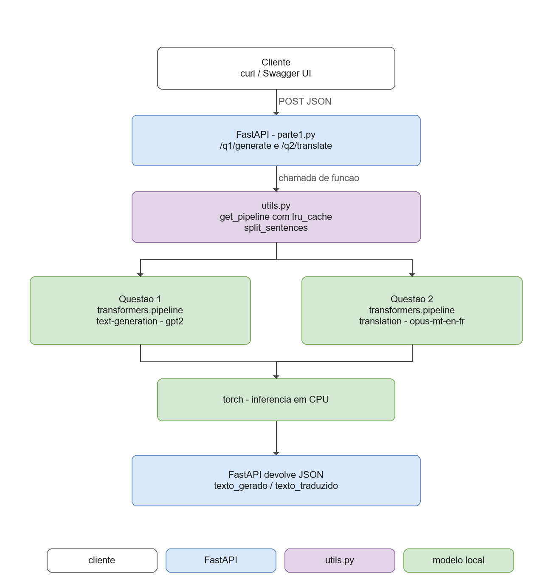

# TP2 - Parte 1 - FastAPI com HuggingFace

## Arquitetura da Parte 1

A Parte 1 roda os modelos localmente, sem LangChain e sem chamada de rede. O arquivo `parte1.py` expoe os dois endpoints e o `utils.py` concentra o carregamento dos pipelines.

## Questao 3: Limitacoes do modelo Helsinki-NLP/opus-mt-en-fr

**Resumo:** modelo pequeno e barato de rodar, com traducao literal frase a frase; erra em texto tecnico e em linguagem informal, e escala mal porque cada replica carrega o modelo inteiro na memoria.

### 1. Precisao da traducao

- O modelo e um MarianMT pequeno (cerca de 74 milhoes de parametros), treinado no corpus OPUS. Traduz bem frases gerais, mas erra em textos tecnicos, juridicos ou medicos, onde o vocabulario especializado quase nao aparece no treino.
- Nao tem memoria de contexto entre sentencas: cada frase e traduzida isoladamente, o que gera inconsistencia de genero, de tratamento (tu/vous) e de terminologia ao longo de um texto grande.
- Ambiguidades lexicais sao resolvidas pela estatistica do corpus, nao pelo sentido: "bank" pode virar "banque" mesmo quando se fala de margem de rio.
- Textos longos passam do limite de tokens e sao truncados. Na implementacao foi necessario quebrar o texto em sentencas, na funcao `translate_long`, para evitar perda de conteudo.
- Nao preserva bem formatacao, marcacao HTML, nomes proprios e numeros com unidade.

### 2. Tempo de resposta e desempenho em escala

- A primeira requisicao paga o custo de download (cerca de 300 MB) e de carregamento do modelo na memoria; por isso o pipeline e cacheado com `lru_cache`.
- Em CPU a inferencia e autorregressiva, gerando token por token: uma frase curta leva centenas de milissegundos e um paragrafo pode levar varios segundos.
- O endpoint e sincrono e o modelo roda no mesmo processo: requisicoes concorrentes competem pela CPU e pelo GIL, formando fila.
- Sem batching o throughput e baixo. Em producao seria necessario agrupar requisicoes, usar GPU, ONNX Runtime ou CTranslate2, ou ainda um servidor dedicado como TorchServe, Triton ou TGI.

### 3. Custo e escalabilidade

- Nao ha custo por token, mas ha custo fixo de infraestrutura: cada replica precisa de aproximadamente 1 GB de RAM apenas para modelo e runtime, e GPU encarece muito a hora de maquina.
- Escalar significa replicar o processo inteiro com o modelo dentro, o que gasta memoria de forma redundante e torna o cold start lento em ambientes serverless.
- Cada par de idiomas exige um modelo diferente (en-fr, en-de, en-pt), multiplicando consumo de memoria e complexidade de deploy.
- Em troca, o custo e previsivel e os dados nao saem da infraestrutura propria, o que e vantagem quando ha requisitos de privacidade.

### 4. Girias, expressoes idiomaticas e contexto

- Expressoes idiomaticas tendem a ser traduzidas literalmente: "it is raining cats and dogs" nao vira "il pleut des cordes".
- Girias, memes, abreviacoes de internet e erros de digitacao estao mal representados no corpus OPUS, formado em sua maior parte por textos oficiais, legendas e documentacao, o que gera saidas sem sentido.
- Nao ha controle de registro: nao e possivel pedir tom formal ou informal, nem fixar glossario, como se faria com um LLM instruido via prompt.
- Humor, ironia, duplo sentido e referencias culturais sao perdidos, porque o modelo nao modela intencao, apenas correspondencia estatistica entre sequencias.

## Questao 4: Limitacoes do GPT-2 na geracao de texto

**Resumo:** completa texto com fluencia, mas nao segue instrucoes, perde coerencia em poucas frases, alucina fatos e nao tem nenhum filtro de seguranca; a latencia cresce com o numero de tokens pedidos.

### 1. Coerencia do texto gerado

- O GPT-2 base, com 124 milhoes de parametros, mantem coerencia local por poucas frases e depois perde o fio: muda de assunto, repete estruturas e contradiz o que escreveu antes.
- A janela de contexto e de 1024 tokens; textos longos perdem o inicio do prompt.
- Com `do_sample=True` a saida muda a cada chamada, ou seja, nao e determinista; com sampling desligado, o texto cai em loops repetitivos.
- Nao segue instrucoes: e um modelo apenas de completacao, sem instruction tuning nem RLHF. Pedir "resuma isso" tende a produzir continuacao do texto, nao um resumo.

### 2. Falhas e incoerencias tipicas de LLMs

- Alucinacao: inventa nomes, datas, numeros e citacoes com total fluencia e nenhuma base factual.
- Conhecimento congelado em 2019, quando o corpus WebText foi coletado, sem qualquer acesso a informacao atual.
- Sensibilidade ao prompt: pequenas mudancas de redacao produzem saidas muito diferentes.
- Raciocinio aritmetico e logico pouco confiavel, por ser apenas um preditor do proximo token.
- Repeticao degenerativa e frases truncadas quando o limite de tokens e atingido no meio da sentenca.

### 3. Desempenho e latencia

- A geracao e autorregressiva: a latencia cresce linearmente com `max_new_tokens`, e em CPU cada token custa dezenas de milissegundos.
- O carregamento inicial do modelo, cerca de 500 MB, atrasa a primeira requisicao; o cache em memoria resolve somente a partir da segunda.
- Sem streaming, o cliente espera toda a geracao terminar; o ideal seria devolver tokens incrementalmente.
- Como o endpoint e sincrono e limitado por CPU, poucas requisicoes simultaneas ja saturam o servidor. Em escala seria necessario GPU, batching e um pool de workers.

### 4. Geracao de conteudo apropriado

- O GPT-2 nao tem alinhamento nem filtro de seguranca: pode gerar conteudo ofensivo, toxico, preconceituoso ou explicito a partir de prompts inocentes.
- Reproduz vieses de genero, raca e nacionalidade presentes no WebText.
- Pode memorizar e reproduzir trechos literais do treino, com risco de direito autoral e de vazamento de dados.
- Nao tem recusa, nem moderacao, nem citacao de fontes; qualquer uso real exigiria uma camada externa de filtragem de conteudo e validacao humana.
